

<picture><source media="(max-width: 600px)" srcset="assets/en/hero-phone.svg"></picture>


<h2 align="center">Projects · 絵馬</h2>

<a href="https://sky9262.github.io"></a>
<a href="https://sky9262.github.io"></a>

<a href="https://sky9262.github.io"></a>
<a href="https://sky9262.github.io"></a>

<a href="https://github.com/sky9262/phishEye"></a>
<a href="https://huggingface.co/sky9262/whisper-base-japanese-anime"></a>

<picture><source media="(max-width: 600px)" srcset="assets/en/cando-phone.svg"></picture>

<picture><source media="(max-width: 600px)" srcset="assets/en/stack-phone.svg"></picture>

<h2 align="center">Activity · 千本鳥居</h2>

<picture><source media="(max-width: 600px)" srcset="https://raw.githubusercontent.com/sky9262/sky9262/output-test/en/torii-phone.svg"></picture>

<picture><source media="(max-width: 600px)" srcset="https://raw.githubusercontent.com/sky9262/sky9262/output-test/en/feed-phone.svg"></picture>




<h3 align="center">Achievements · Charms</h3>




<a href="https://www.hackerrank.com/profile/sky9262"></a>
<a href="https://picoctf.org"></a>

<a href="https://ctftime.org/team/75661"></a>

<a href="https://tryhackme.com/p/sky9262"><picture><source media="(max-width: 600px)" srcset="assets/en/thm-shelf-phone.svg"></picture></a>

<picture><source media="(max-width: 600px)" srcset="assets/en/connect-phone.svg"></picture>

 <em>I love connecting with different people so if you want to say <b>hi</b>, I'll be happy to meet you more! <b>😊</b></em>

Thanks for visiting the shrine.

