

<picture><source media="(max-width: 600px)" srcset="assets/jp/hero-phone.svg"></picture>

<h2 align="center">絵馬 · プロジェクト</h2>

<a href="https://sky9262.github.io"></a>
<a href="https://sky9262.github.io"></a>

<a href="https://sky9262.github.io"></a>
<a href="https://sky9262.github.io"></a>

<a href="https://github.com/sky9262/phishEye"></a>
<a href="https://huggingface.co/sky9262/whisper-base-japanese-anime"></a>

<picture><source media="(max-width: 600px)" srcset="assets/jp/cando-phone.svg"></picture>

<picture><source media="(max-width: 600px)" srcset="assets/jp/stack-phone.svg"></picture>

<h2 align="center">千本鳥居 · 活動</h2>

<picture><source media="(max-width: 600px)" srcset="https://raw.githubusercontent.com/sky9262/sky9262/output-test/jp/torii-phone.svg"></picture>

<picture><source media="(max-width: 600px)" srcset="https://raw.githubusercontent.com/sky9262/sky9262/output-test/jp/feed-phone.svg"></picture>




<h3 align="center">御守り · 実績と認定</h3>




<picture><source media="(max-width: 600px)" srcset="assets/jp/connect-phone.svg"></picture>

ご参拝いただき、ありがとうございました。

